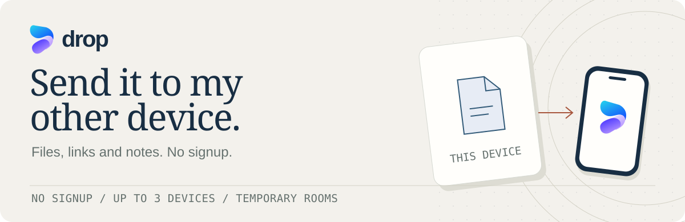
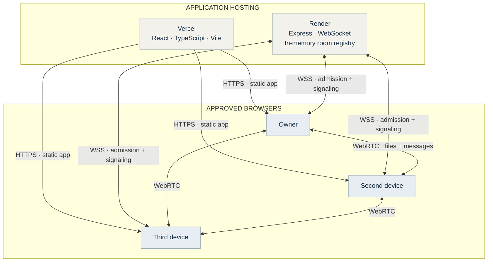
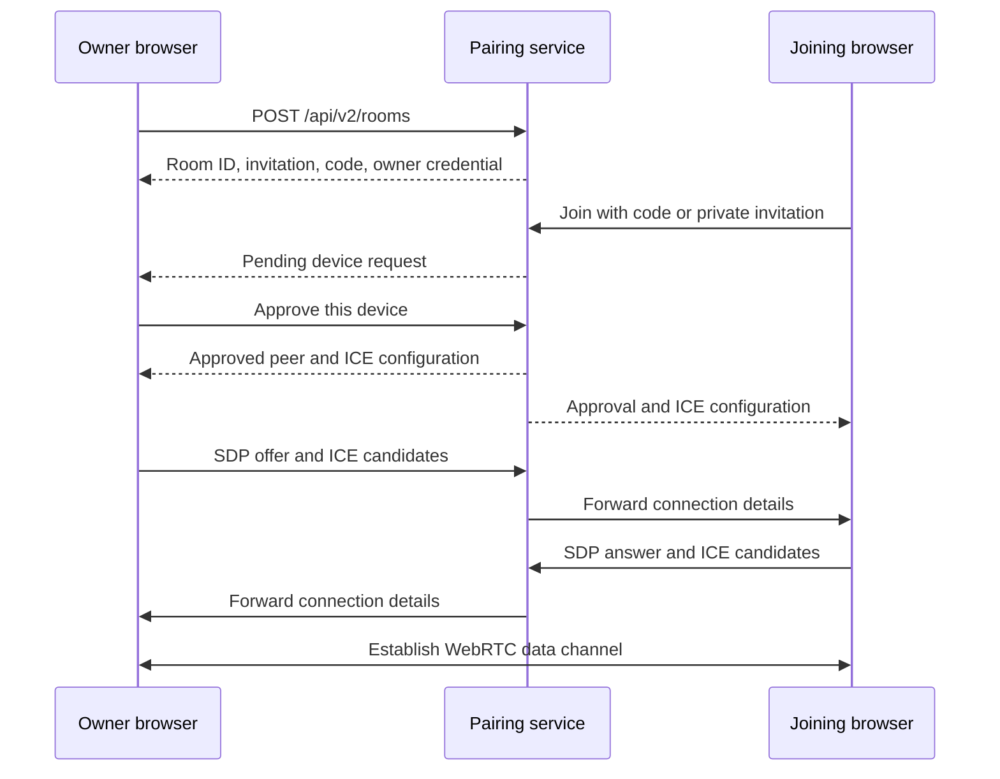
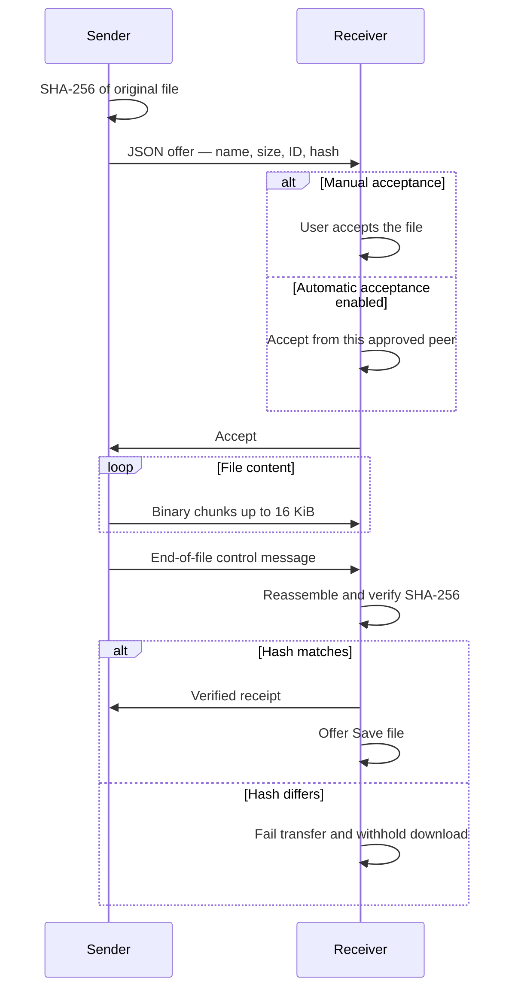

<div align="center">



<br>

<a href="https://dropem.vercel.app/app"></a>
<a href="https://dropem.vercel.app/"></a>
<a href="#run-locally"></a>

<br><br>

[](https://github.com/Pranav-Teja-Aluvala/Drop/actions/workflows/checks.yml)
[](LICENSE)

</div>

## From one screen to the next

Create a room, connect your devices, and send the thing you need on your other screen. Drop runs in your browser and supports up to three devices.

<table>
<tr>
<td width="50%" valign="top"><strong>Pair your way</strong><br><br>Scan a QR, enter a five-digit code, or open an invitation link. The owner approves each new device once.</td>
<td width="50%" valign="top"><strong>Keep the original</strong><br><br>Send any file extension up to 50 MiB. SHA-256 verifies the received bytes before the download becomes available.</td>
</tr>
<tr>
<td valign="top"><strong>Pick up the conversation</strong><br><br>Send links and notes through room chat. Copy a message, expand a long one, or continue on your other device.</td>
<td valign="top"><strong>Choose what arrives</strong><br><br>Accept files individually or enable automatic acceptance for this room. Received files stay available in the Files tab until the page is cleared.</td>
</tr>
</table>

## Take a look


<details>
<summary><strong>Open the product gallery</strong> — Transfer room and mobile chat</summary>

### Transfer room


### Mobile chat


These screenshots use temporary local rooms and synthetic messages. Those rooms have ended.

</details>

## One room. Three steps.

| Create | Connect | Send |
| :--- | :--- | :--- |
| Open Drop on your first device and create a room. | Scan the QR or enter the code. Compare the room name and approve the new device. | Browse for a file or open Chat. Accept the incoming file and choose Save. |

With three devices, choose a recipient from the device list. Automatic acceptance skips individual prompts for approved devices and resets when leaving or reloading. Saving a download still requires your action.

## System architecture

The frontend serves the interface. The pairing service coordinates admission and connections. Files and messages travel over WebRTC between the selected devices.



<details>
<summary><strong>Connection architecture</strong> — From invitation to encrypted channel</summary>



**Admission.** The five-digit code finds a room. The six-letter name is a screen comparison aid. Owner approval grants admission, and each device receives a separate return credential.

**Network discovery.** ICE selects a route, using STUN to discover network addresses. The public deployment has no TURN relay, so some mobile networks, VPNs and firewalls cannot connect.

**Recovery.** A tab session credential can restore an approved connection within the ten-minute return window. Room membership lives in one server process. Server restarts clear active rooms; independent replicas cannot share this registry.

Implementation entry points are the [room lifecycle](src/useRoom.ts), [pairing service](server/v2.mjs) and [ICE configuration](server/ice.mjs).

</details>

<details>
<summary><strong>Transfer protocol</strong> — Offer, accept, stream, verify</summary>



| Layer | What Drop uses it for |
| :--- | :--- |
| **HTTPS / WSS** | Serve the application and coordinate room admission and WebRTC signaling. |
| **SDP / ICE / STUN** | Exchange connection descriptions and candidates, then find a network route. |
| **RTCDataChannel** | Carry file metadata, binary chunks and messages over an ordered, reliable channel. |
| **SCTP / DTLS** | Browser-managed data-channel transport and encryption in transit. |
| **Web Crypto / SHA-256** | Hash file contents and verify received bytes before exposing a download. |
| **JSON control messages** | Offers, acceptance, cancellation, receipts and message acknowledgements. |

The [transfer implementation](src/transfer.ts) applies file-size limits, buffered-data backpressure, timeouts and integrity checks. Interrupted files must be sent again.

</details>

<details>
<summary><strong>Data lifecycle and trust boundaries</strong> — Where things live</summary>

| Location | What lives there | Lifetime |
| :--- | :--- | :--- |
| Browser memory | Files, unsaved downloads and chat | Until reload, page termination or room cleanup |
| Tab session storage | Room return credential and owner invitation | Cleared when ending the room; server expiry remains authoritative |
| Pairing service memory | Membership, invitation codes, credentials and signaling state | Room expiry or server restart |
| Device storage | Files explicitly saved by the recipient | Until the user removes them |

The pairing service has no file store. The site and pairing service are trusted to introduce peers. Files and archives are not scanned for malware, and local browser storage is not a separately encrypted vault.

</details>

## Run locally

**Node.js 24 · npm · No database required**

```sh
git clone https://github.com/Pranav-Teja-Aluvala/Drop.git
cd Drop
npm ci
npm run dev
```

Open [localhost:5173/app](http://localhost:5173/app). Use a second browser profile to test pairing on one computer. A physical phone needs a reachable HTTPS deployment.

<details>
<summary><strong>Production preview and deployment</strong></summary>

```sh
npm run build
npm run preview:v2
```

The preview runs at [localhost:5174](http://localhost:5174/).

| Environment variable | Host | Value |
| :--- | :--- | :--- |
| `PUBLIC_ORIGIN` | Pairing server | Exact public HTTPS frontend origin, without a trailing slash |
| `VITE_SIGNAL_ORIGIN` | Frontend build | Public HTTPS pairing-service origin |
| `SITE_ORIGIN` | Frontend build | Canonical frontend origin for sitemap and metadata |
| `PORT` | Pairing server | Port supplied by your host |

Build the pairing service with `npm ci && npm run build`, start it with `npm start`, and check `/api/health`. Publish the frontend's `dist/` and serve the app entry at `/app`.

See [.env.example](.env.example), [vercel.json](vercel.json), [render.yaml](render.yaml) and the [Dockerfile](Dockerfile). Keep optional TURN credentials on the server. Variables prefixed with `VITE_` become public frontend code.

</details>

<details>
<summary><strong>Tests and release checks</strong></summary>

```sh
npm run build
npm test
npx playwright install chromium
npm run test:beta
npm run check:release
npm audit --omit=dev
npm run check:secrets -- --history
```

Tests exercise recipient isolation, unchanged downloads, code expiry, approval, automatic acceptance, recovery, long messages, rotation and responsive sizing. Use `PLAYWRIGHT_CHANNEL=chrome` for an installed Chrome.

For your own hosted instance, set `TEST_BASE_URL` and `TEST_SIGNAL_ORIGIN` before running `npm run check:live`. The default targets the public Drop service.

</details>

## Current limits

| Devices | Files | Messages | Sessions |
| :--- | :--- | :--- | :--- |
| 3 per room | 50 MiB per file | 50,000 characters; latest 200 retained | 2-hour rooms; 10-minute invitation and return windows |

Keep both pages open while transferring. Reloading clears unsaved files and chat. The current public service uses direct connections and has no relay fallback.

## Help and project resources

<table>
<tr>
<td width="33%" valign="top"><a href="https://dropem.vercel.app/connection-help.html"><strong>Connection help ↗</strong></a><br><sub>Pairing, recovery and network limitations</sub></td>
<td width="33%" valign="top"><a href="https://dropem.vercel.app/contact.html"><strong>Contact ↗</strong></a><br><sub>Support and privacy questions</sub></td>
<td width="33%" valign="top"><a href="https://github.com/Pranav-Teja-Aluvala/Drop/issues/new"><strong>Report an issue ↗</strong></a><br><sub>Reproduction steps and device details</sub></td>
</tr>
<tr>
<td valign="top"><a href="https://dropem.vercel.app/privacy.html"><strong>Privacy ↗</strong></a><br><sub>Data handling and retention</sub></td>
<td valign="top"><a href="https://dropem.vercel.app/cookies.html"><strong>Cookies &amp; local data ↗</strong></a><br><sub>Browser storage and offline assets</sub></td>
<td valign="top"><a href="https://dropem.vercel.app/terms.html"><strong>Terms ↗</strong></a><br><sub>Service conditions and safe sharing</sub></td>
</tr>
</table>

Contributions are welcome. Include the affected flow and checks run in a pull request. Report sensitive findings through [SECURITY.md](SECURITY.md).

Original code and documentation are [MIT licensed](LICENSE). Branding and artwork are reserved under the [licensing scope](LICENSING.md). Dependencies retain their own licenses; see [third-party notices](https://dropem.vercel.app/third-party-notices.html).

<div align="center">

<a href="https://github.com/Pranav-Teja-Aluvala/Drop"></a>
<a href="https://dropem.vercel.app/contact.html"></a>
<a href="https://dropem.vercel.app/privacy.html"></a>

</div>
