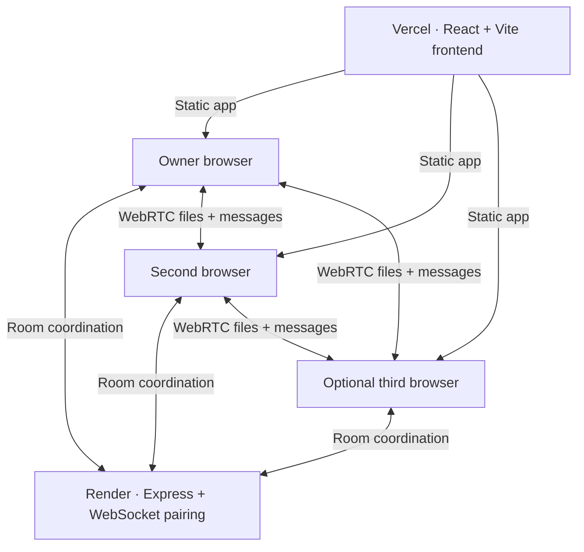

<div align="center">


# Send it to my other device.

Files, links and notes. A temporary room for the screens you use.

[](https://dropem.vercel.app/app)
[](https://dropem.vercel.app/)
[](https://github.com/Pranav-Teja-Aluvala/Drop/actions/workflows/checks.yml)

**No signup · Up to 3 devices · Direct browser transfers**


[How it works](#how-it-works) · [Inside the app](#inside-the-app) · [Run locally](#run-locally) · [Architecture](#system-architecture) · [Contribute](#contributing)

</div>

## A place between your devices

<table>
<tr>
<td width="50%" valign="top">

**Scan. Pair. Send.**

Open the private QR, enter a five-digit code, or use an invitation link. The room owner approves each new device once.

</td>
<td width="50%" valign="top">

**Your original file**

Send any extension up to 50 MiB. The receiver verifies the bytes with SHA-256 before offering the download.

</td>
</tr>
<tr>
<td valign="top">

**A conversation across screens**

Share a link, an address or a note in room chat. Sent and received messages stay together, with copy controls and expandable long messages.

</td>
<td valign="top">

**Your choice to accept**

Accept each file individually, or enable automatic acceptance from approved devices for this room. Save received files when you want them.

</td>
</tr>
</table>

## How it works

| Open | Connect | Share |
| :--- | :--- | :--- |
| [Create a room](https://dropem.vercel.app/app) on your first device. | Scan the QR or enter the five-digit code on the other device. Compare the room name and approve once. | Choose the recipient when three devices are connected. Send a file, or switch to **Chat** for text and links. |

Keep both pages open during a transfer. Received files appear in **Files** with a **Save file** button. Automatic acceptance skips the offer prompt and resets when you leave or reload.

## Inside the app

<details open>
<summary><strong>The transfer room</strong> · Devices, invitations and sharing in one workspace</summary>

<br>


</details>

<details>
<summary><strong>Mobile chat</strong> · A conversation that fits your screen</summary>

<br>


Screenshots use temporary local rooms and illustrative messages. Those rooms have ended.

</details>

## Before you share

| What to know | Current behavior |
| :--- | :--- |
| Room size | Up to **3 devices**, including the owner. Delivery goes to the selected recipient. |
| Room lifetime | Up to **2 hours**. Invitations and five-digit codes expire after **10 minutes**. |
| Returning to a room | Approved devices have a **10-minute return window**. The same tab can recover its connection using a temporary return credential. |
| Files | **50 MiB per file**, any extension. Interrupted transfers must be sent again. |
| Messages | Up to **50,000 characters** each. The page retains the latest 200 messages. |
| Browser storage | File contents and messages stay in page memory. Reloading clears unsaved content. Return credentials use tab session storage. |
| Networks | The public deployment has **no TURN relay**. Some mobile networks, VPNs and firewalls cannot establish a direct connection. |

Files travel over encrypted WebRTC data channels. The website and pairing service remain trusted parts of the connection. A short code requests access; owner approval grants it. Files and archives are **not scanned for malware**.

[Privacy policy](https://dropem.vercel.app/privacy.html) · [Cookies & local data](https://dropem.vercel.app/cookies.html) · [Terms](https://dropem.vercel.app/terms.html) · [Connection help](https://dropem.vercel.app/connection-help.html) · [Contact](https://dropem.vercel.app/contact.html)

## Run locally

Use **Node.js 24** and npm. Local development needs no provider account or database.

```sh
git clone https://github.com/Pranav-Teja-Aluvala/Drop.git
cd Drop
npm ci
npm run dev
```

Open [localhost:5173/app](http://localhost:5173/app). Pair with a second browser profile to test on one computer. A physical phone needs a reachable HTTPS deployment; its localhost points to the phone itself.

<details>
<summary><strong>Production preview</strong></summary>

```sh
npm run build
npm run preview:v2
```

Open [localhost:5174](http://localhost:5174/). The preview serves the built frontend with a local pairing service.

</details>

## System architecture



<details>
<summary><strong>Pairing, delivery and recovery</strong></summary>

- **Pairing** starts at `POST /api/v2/rooms`. Browsers use `/signal-v2` for admission, owner approval, membership and WebRTC signaling. Five-digit codes discover rooms; six-letter room names let users compare screens. Neither replaces owner approval.
- **Delivery** uses a separate WebRTC data channel for each approved pair. The sender offers metadata, the recipient accepts manually or through the room preference, and SHA-256 verifies the received bytes. The pairing server has no file store.
- **Recovery** uses a per-device return credential in tab session storage. File buffers and chat remain in page memory. The pairing service keeps rooms in one process, so server restarts clear active rooms.

| Code | Responsibility |
| :--- | :--- |
| [App](src/App.tsx), [components](src/components.tsx), [room activity](src/RoomActivity.tsx) | Room controls, invitations, file offers, downloads and chat |
| [Room hook](src/useRoom.ts), [transfer protocol](src/transfer.ts) | Connection lifecycle, peer selection, transfers and recovery |
| [Pairing server](server/v2.mjs), [ICE configuration](server/ice.mjs) | Admission, room limits, signaling and optional relay configuration |
| [Browser tests](tests/browser/v2.spec.ts), [server tests](tests/v2-server.test.mjs) | Product flows, isolation, expiry and regressions |

</details>

<details>
<summary><strong>Self-hosting and environment variables</strong></summary>

Deploy the frontend as static files on Vercel and run the pairing service as one long-running Node process. Independent server replicas do not share the current in-memory room registry.

| Variable | Where | Purpose |
| :--- | :--- | :--- |
| `PUBLIC_ORIGIN` | Pairing service | Exact HTTPS frontend origin without a trailing slash |
| `VITE_SIGNAL_ORIGIN` | Frontend build | Public HTTPS pairing-service origin |
| `SITE_ORIGIN` | Frontend build | Canonical URLs, sitemap and social metadata |
| `PORT` | Pairing service | Listening port supplied by the host |

1. Run `npm ci && npm run build` on the pairing host and start it with `npm start`. Check `/api/health`.
2. Build the frontend with its environment variables and publish `dist/`. Serve the app entry at `/app`.
3. Set `TEST_BASE_URL` and `TEST_SIGNAL_ORIGIN` to your deployed origins, then run `npm run check:live`.

See the [environment example](.env.example), [Vercel configuration](vercel.json), [Render blueprint](render.yaml) and [Dockerfile](Dockerfile). Optional TURN settings live on the server. Variables prefixed with `VITE_` become public frontend code.

</details>

<details>
<summary><strong>Checks and test commands</strong></summary>

```sh
npm run build
npm test
npx playwright install chromium
npm run test:beta
npm run check:release
npm audit --omit=dev
npm run check:secrets -- --history
```

The browser suite uses the production bundle and synthetic files. It exercises three-device recipient isolation, unchanged downloads, code joining, approval, automatic acceptance, tab recovery, chat scrolling, expandable messages and responsive layouts.

The release check covers page status codes, headings, image descriptions, internal anchors, metadata and exposed-file probes. `npm run check:live` checks the deployed app; its default targets the public Drop service. Use `PLAYWRIGHT_CHANNEL=chrome` to test with an installed Chrome.

[View CI runs](https://github.com/Pranav-Teja-Aluvala/Drop/actions/workflows/checks.yml)

</details>

## Contributing

[Report a bug](https://github.com/Pranav-Teja-Aluvala/Drop/issues/new) with your browser, device, network type and reproduction steps using a synthetic file. Pull requests should explain the affected flow and the checks run. Share sensitive findings through the [security reporting instructions](SECURITY.md).

## License

Original code and documentation are [MIT licensed](LICENSE). Drop branding and artwork are reserved. Dependencies keep their own licenses.

[Licensing scope](LICENSING.md) · [Third-party notices](https://dropem.vercel.app/third-party-notices.html) · [Source notices](public/licenses.txt)

---

<div align="center">

**Have something on the wrong screen?**

[Open Drop](https://dropem.vercel.app/app) · [View the source](https://github.com/Pranav-Teja-Aluvala/Drop) · [Get help](https://dropem.vercel.app/contact.html)

</div>
