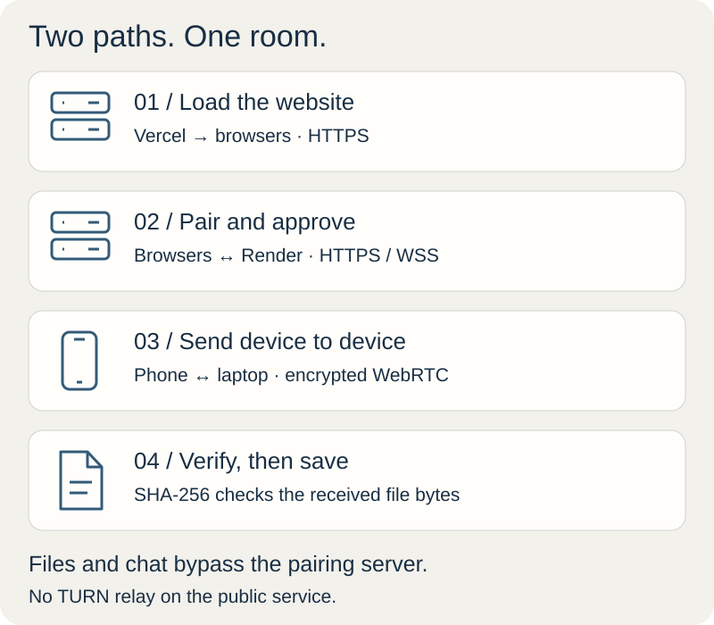
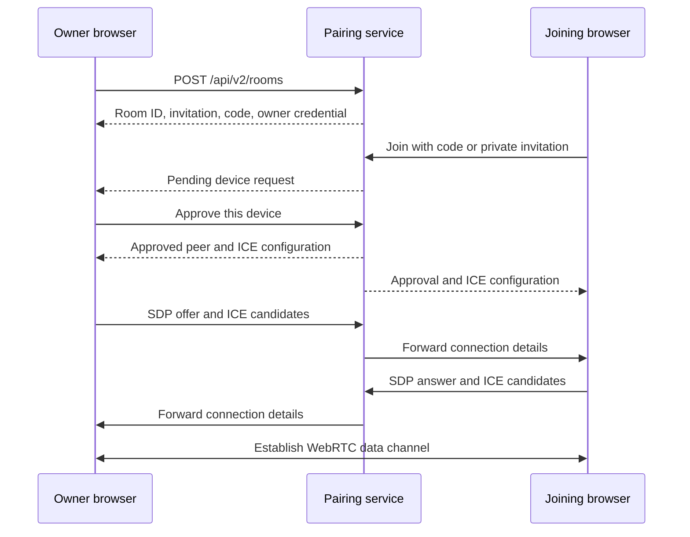
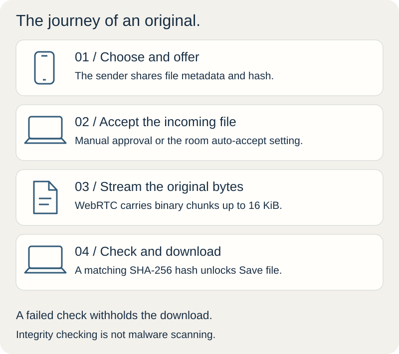
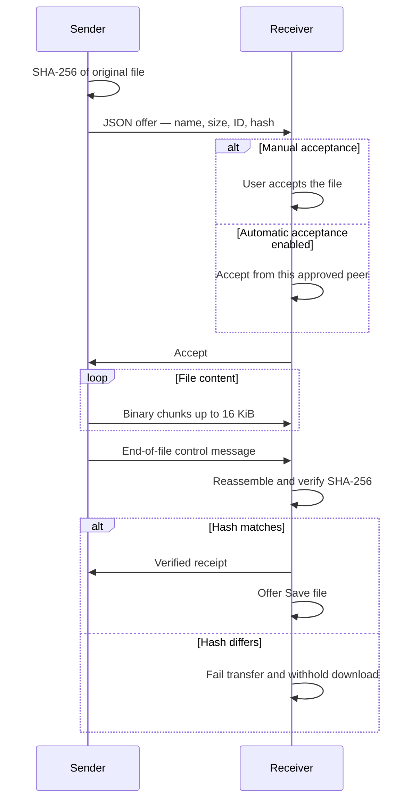

<div align="center">


<br>

<a href="https://dropem.vercel.app/app"></a>

**A photo on your phone. The original on your laptop.**<br>
Files, links and notes between up to three devices. No signup.

</div>

<p align="center">
<a href="#features">Features</a> ·
<a href="#getting-started">Getting started</a> ·
<a href="#how-it-works">How it works</a> ·
<a href="#development">Development</a> ·
<a href="#contributing">Contributing</a>
</p>

<a href="https://dropem.vercel.app/app"></a>

## Features

- **Files, links and notes.** Send any file extension or use room chat to move text between screens.
- **No signup.** Pair up to three browsers with a QR, a five-digit code or a private invitation.
- **An original, checked on arrival.** Files travel over encrypted WebRTC; SHA-256 verifies the received bytes.
- **Your choice to accept.** Approve each incoming file or enable automatic acceptance for this room.
- **A temporary workspace.** Downloads and messages stay in page memory. Save what you need before leaving.

<details>
<summary><strong>Look inside the product</strong> — Homepage and mobile chat</summary>


Screenshots show temporary local rooms and illustrative messages. Those rooms have ended.

</details>

## Getting started

1. **Create a room** on your laptop.
2. **Join from your phone** by scanning the QR or entering the five-digit code. Compare the room name, then approve the phone on your laptop once.
3. **Choose a photo** on your phone. Accept it on your laptop and select **Save file**.

With three devices, choose the recipient in the device list. Automatic acceptance resets on leaving or reloading; saving remains your choice.

> [!NOTE]
> Keep both pages open during a transfer. The public service has no TURN relay, so some mobile networks, VPNs and firewalls cannot connect. See [connection help](https://dropem.vercel.app/connection-help.html).

## How it works

**The pairing server exchanges connection details; files and chat travel between the approved browsers.** The website serves the app over HTTPS, and the pairing service handles admission and WebRTC signaling over HTTPS/WebSocket.

[](docs/readme/architecture.svg)

Owner approval precedes transfer. SHA-256 verifies file integrity after receipt. It does not scan for malware, and the website and pairing service remain trusted components.

<details>
<summary><strong>Connection architecture</strong> — From invitation to encrypted channel</summary>



**Admission.** The five-digit code finds a room. The six-letter name is a screen comparison aid. Owner approval grants admission, and each device receives a separate return credential.

**Network discovery.** ICE selects a route, using STUN to discover network addresses. The public deployment has no TURN relay, so some mobile networks, VPNs and firewalls cannot connect.

**Recovery.** A tab session credential can restore an approved connection within the ten-minute return window. Room membership lives in one server process. Server restarts clear active rooms; independent replicas cannot share this registry.

Implementation entry points are the [room lifecycle](src/useRoom.ts), [pairing service](server/v2.mjs) and [ICE configuration](server/ice.mjs).

</details>

<details>
<summary><strong>Transfer protocol</strong> — Offer, accept, stream, verify</summary>

[](docs/readme/transfer-path.svg)



| Layer | What Drop uses it for |
| :--- | :--- |
| **HTTPS / WSS** | Serve the application and coordinate room admission and WebRTC signaling. |
| **SDP / ICE / STUN** | Exchange connection descriptions and candidates, then find a network route. |
| **RTCDataChannel** | Carry file metadata, binary chunks and messages over an ordered, reliable channel. |
| **SCTP / DTLS** | Browser-managed data-channel transport and encryption in transit. |
| **Web Crypto / SHA-256** | Hash file contents and verify received bytes before exposing a download. |
| **JSON control messages** | Offers, acceptance, cancellation, receipts and message acknowledgements. |

The [transfer implementation](src/transfer.ts) applies file-size limits, buffered-data backpressure, timeouts and integrity checks. Interrupted files must be sent again.

</details>

<details>
<summary><strong>Data lifecycle and trust boundaries</strong> — Where things live</summary>

| Location | What lives there | Lifetime |
| :--- | :--- | :--- |
| Browser memory | Files, unsaved downloads and chat | Until reload, page termination or room cleanup |
| Tab session storage | Room return credential and owner invitation | Cleared when ending the room; server expiry remains authoritative |
| Pairing service memory | Membership, invitation codes, credentials and signaling state | Room expiry or server restart |
| Device storage | Files explicitly saved by the recipient | Until the user removes them |

The pairing service has no file store. The site and pairing service are trusted to introduce peers. Files and archives are not scanned for malware, and local browser storage is not a separately encrypted vault.

</details>

## Development

### Run locally

**Node.js 24 · npm · No database required**

```sh
git clone https://github.com/Pranav-Teja-Aluvala/Drop.git
cd Drop
npm ci
npm run dev
```

Open [localhost:5173/app](http://localhost:5173/app). Use a second browser profile to test pairing on one computer. A physical phone needs a reachable HTTPS deployment.

<details>
<summary><strong>Production preview and deployment</strong></summary>

```sh
npm run build
npm run preview:v2
```

The preview runs at [localhost:5174](http://localhost:5174/).

| Environment variable | Host | Value |
| :--- | :--- | :--- |
| `PUBLIC_ORIGIN` | Pairing server | Exact public HTTPS frontend origin, without a trailing slash |
| `VITE_SIGNAL_ORIGIN` | Frontend build | Public HTTPS pairing-service origin |
| `SITE_ORIGIN` | Frontend build | Canonical frontend origin for sitemap and metadata |
| `PORT` | Pairing server | Port supplied by your host |

Build the pairing service with `npm ci && npm run build`, start it with `npm start`, and check `/api/health`. Publish the frontend's `dist/` and serve the app entry at `/app`.

See [.env.example](.env.example), [vercel.json](vercel.json), [render.yaml](render.yaml) and the [Dockerfile](Dockerfile). Keep optional TURN credentials on the server. Variables prefixed with `VITE_` become public frontend code.

</details>

<details>
<summary><strong>Tests and release checks</strong></summary>

```sh
npm run build
npm test
npx playwright install chromium
npm run test:beta
npm run check:release
npm audit --omit=dev
npm run check:secrets -- --history
```

Tests exercise recipient isolation, unchanged downloads, code expiry, approval, automatic acceptance, recovery, long messages, rotation and responsive sizing. Use `PLAYWRIGHT_CHANNEL=chrome` for an installed Chrome.

For your own hosted instance, set `TEST_BASE_URL` and `TEST_SIGNAL_ORIGIN` before running `npm run check:live`. The default targets the public Drop service.

</details>

## Limits and privacy

| Devices | Files | Messages | Sessions |
| :--- | :--- | :--- | :--- |
| 3 per room | 50 MiB per file | 50,000 characters; latest 200 retained | 2-hour rooms; 10-minute invitation and return windows |

The receiver caps retained files at 20 files / 150 MiB per peer connection to bound memory use.

Keep both pages open while transferring. Reloading clears unsaved files and chat. The current public service uses direct connections and has no relay fallback.

## Contributing

Bug reports and pull requests are welcome. Include your browser, device, network type, reproduction steps and the checks you ran. Use a synthetic file when reporting a transfer issue.

| Get involved | Help and privacy |
| :--- | :--- |
| [Report a bug](https://github.com/Pranav-Teja-Aluvala/Drop/issues/new) | [Contact](https://dropem.vercel.app/contact.html) |
| [Build checks](https://github.com/Pranav-Teja-Aluvala/Drop/actions/workflows/checks.yml) | [Privacy policy](https://dropem.vercel.app/privacy.html) |
| [Report a vulnerability](SECURITY.md) | [Cookies and local data](https://dropem.vercel.app/cookies.html) |
| [Project website](https://dropem.vercel.app/) | [Terms](https://dropem.vercel.app/terms.html) |

## License

Original code and documentation are [MIT licensed](LICENSE). Drop branding and artwork are reserved; see [licensing scope](LICENSING.md). Dependencies retain their own licenses in the [third-party notices](https://dropem.vercel.app/third-party-notices.html).
