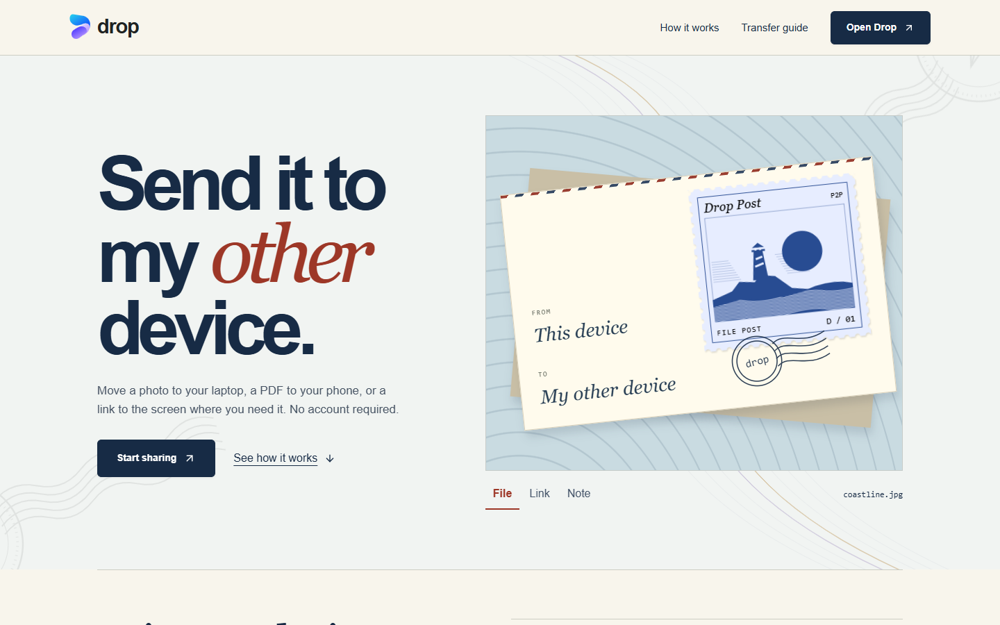
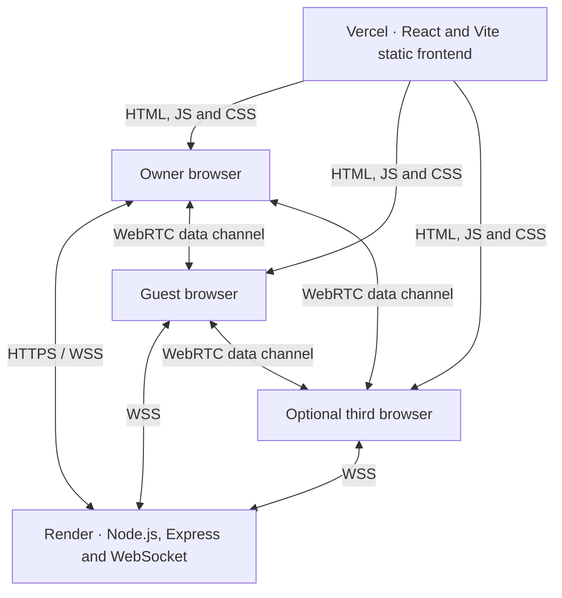

# Send it to my other device

Send a file, link or note from one browser to another. Create a temporary room on your laptop, scan its QR with your phone, and choose which device should receive the next item. A room supports up to three devices without an account or an installed app.

[Open Drop](https://shareem.vercel.app/app) · [Privacy](https://shareem.vercel.app/privacy.html) · [Build checks](https://github.com/Pranav-Teja-Aluvala/Drop/actions/workflows/checks.yml)



## Try a transfer

1. Open a room on the first device. Scan its private QR or open the invite link on the second.
2. Compare the six-letter room name on both screens. The owner approves each new device once.
3. Select a recipient and browse for a file. On the receiving screen, accept the offer and save the download. For a link or note, use **Chat** instead.

Keep both pages open during transfers. Files are delivered individually to the selected recipient, including in a three-device room.

## System architecture



**Pairing.** The owner calls `POST /api/v2/rooms`. Each browser connects to `/signal-v2` to join, request approval, exchange connection descriptions and ICE candidates, and receive membership updates. The six-letter room name is a visual cross-check. Admission requires a private credential and owner approval.

**Delivery.** Each approved pair establishes its own WebRTC data channel. The sender offers the filename and size, the recipient accepts or declines, and accepted bytes are checked with SHA-256 before a download is offered. Notes travel over the selected peer connection. The signaling service handles coordination and holds no file store.

**Recovery.** The server keeps membership and timers in one process. The same tab can use a credential in session storage to rejoin after an app switch or reload. Files and chat stay in memory and are lost on reload. Restarting the server clears active rooms.

| Limit | Behavior |
| --- | --- |
| Room size and duration | Three devices including the owner, for up to two hours |
| Invitation and return window | Ten minutes to use an initial invite; up to ten minutes to return after switching apps |
| Files | Any extension, up to 50 MiB each; interrupted files must be resent |
| Chat | Up to 50,000 characters per message; save important text before leaving |
| Networks | The public service uses direct connections. Some VPNs, firewalls and mobile networks require a TURN relay and cannot connect in this configuration. |

## Local development

Use **Node.js 24** and npm. Local development needs no provider account or database.

```sh
git clone https://github.com/Pranav-Teja-Aluvala/Drop.git
cd Drop
npm ci
npm run dev
```

Open [localhost:5173/app](http://localhost:5173/app). To exercise pairing on one computer, open the invitation in a second browser profile. For a physical phone, use the HTTPS deployment or another reachable HTTPS host. A phone's localhost points to the phone itself.

To test the production bundle locally, run `npm run build`, then `npm run preview:v2` and open [localhost:5174](http://localhost:5174/).

## Verification

```sh
npm run build
npm test
npx playwright install chromium
npm run test:beta
npm run check:release
npm audit --omit=dev
npm run check:secrets -- --history
```

The browser test runner starts local production-build servers and exercises admission, three-device recipient isolation, reconnects, and byte-identical downloads with synthetic files. The release check covers mobile and desktop layouts, metadata, offline-related assets and HTTP behavior. To use an installed Chrome, set `PLAYWRIGHT_CHANNEL=chrome` in your shell.

## Self-hosting

Use one long-running Node service for the pairing server. Multiple independent replicas cannot share the current in-memory room registry. The repository includes a Dockerfile, a Render blueprint and Vercel static hosting configuration.

| Setting | Where | Value |
| --- | --- | --- |
| `PUBLIC_ORIGIN` | Pairing service | Exact HTTPS frontend origin, without a trailing slash |
| `VITE_SIGNAL_ORIGIN` | Frontend build | Public HTTPS pairing-service origin |
| `SITE_ORIGIN` | Frontend build | Public HTTPS frontend origin for canonical URLs and sitemap |
| `PORT` | Node service | Port supplied by the host |

1. Build the pairing service with `npm ci && npm run build`, start it with `npm start`, and check `/api/health`.
2. Build the frontend with `npm run build` and publish `dist/`. The host must serve the app entry at `/app`.
3. For your own deployment, set `TEST_BASE_URL` and `TEST_SIGNAL_ORIGIN` to those HTTPS origins before running `npm run check:live`. The defaults target the public Drop deployment.

See [.env.example](.env.example) for optional relay and trusted-proxy settings. Keep relay credentials on the server. Vite variables are compiled into the public frontend.

## Contributing and security

For a bug report, include the browser, device, network type and steps to reproduce with a synthetic file. For a pull request, describe the affected flow and checks run. Send sensitive findings through the [security reporting instructions](SECURITY.md). Files are encrypted in transit; the site and signaling service are trusted to introduce peers. Recipients should only accept files they expect. Integrity verification does not scan for malware.

## License

Original project code and documentation are [MIT licensed](LICENSE). Drop branding and artwork are reserved. Dependencies retain their own licenses. See [licensing scope](LICENSING.md) and [third-party notices](public/licenses.txt).
