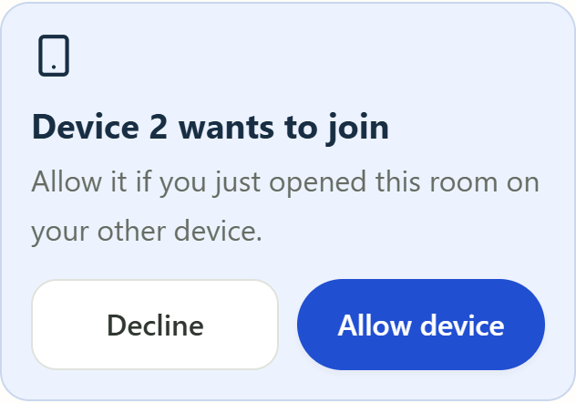
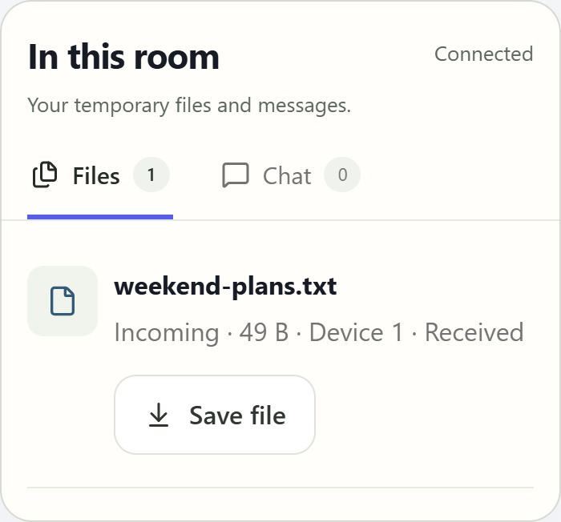

<p align="center"></p>

<h1 align="center">Drop</h1>

<p align="center"><strong>Send it to my other device.</strong><br>
Share files, links, and notes between up to three devices in a temporary browser room.</p>

<p align="center">
  <a href="https://dropem.vercel.app/app"></a>
  <a href="#run-locally"></a>
  <a href="docs/architecture.md"></a>
</p>

<p align="center"><kbd>No account</kbd> &nbsp; <kbd>Up to 3 devices</kbd> &nbsp; <kbd>50 MiB per file</kbd></p>

## From one screen to another

1. **Create a room** on the first device.
2. **Join** on the next device with the QR code, five-digit code, or private link. The room owner taps **Allow device** once.
3. **Send** a file or switch to **Chat** for a link or note. The recipient accepts the file and taps **Save file**.

<p align="center">
  <a href="docs/readme/device-approval.png"></a>
  <a href="docs/readme/file-received.png"></a>
</p>
<p align="center"><sub>Device approval and file receipt captured from a local test room.</sub></p>

## How it works

[WebRTC](docs/architecture.md) carries files and chat between approved browsers. The pairing service handles admission and signaling and stores room state in memory. The receiver verifies the file with SHA-256 before offering the download.

| | |
| :--- | :--- |
| **Rooms** | Up to 3 devices for 2 hours. Invites and join codes expire after 10 minutes. |
| **Returning** | Approved devices can reconnect in the same tab within 10 minutes. Keep both pages open during a transfer and resend interrupted files. |
| **Files** | Up to 50 MiB each. Any file extension is supported. Accept files individually or enable automatic acceptance for the current room. |
| **Chat** | Up to 50,000 characters per message. Copy a note before closing or reloading the tab. |
| **Storage** | Unsaved files and chat live in page memory. Return credentials use tab session storage. |
| **Networks** | The public deployment uses direct connections. Some VPNs, cellular networks, and firewalls can block pairing. [Connection help](https://dropem.vercel.app/connection-help.html) |

Drop does not scan files for malware. Open files only from devices you trust. [Privacy policy](https://dropem.vercel.app/privacy.html)

## Run locally

Use **Node.js 24** and **npm**.

```sh
git clone https://github.com/Pranav-Teja-Aluvala/Drop.git
cd Drop
npm ci
npm run dev
```

Open [localhost:5173/app](http://localhost:5173/app). Use two browser profiles to try a transfer on one computer. A phone needs a reachable HTTPS deployment.

<details>
<summary>Build and test</summary>

```sh
npm run build
npm test
npx playwright install chromium
npm run test:beta
npm run check:release
```

Use `npm run preview:v2` to serve the built app at [localhost:5174](http://localhost:5174/). Use `PLAYWRIGHT_CHANNEL=chrome` to run the browser suite with an installed Chrome. [GitHub Actions](https://github.com/Pranav-Teja-Aluvala/Drop/actions/workflows/checks.yml)

</details>

<details>
<summary>Self-hosting</summary>

Publish `dist/` on a static host and serve the app at `/app`. Run the pairing service as one long-lived Node process with `npm start` and check `/api/health`. A server restart ends active rooms.

| Set on | Setting |
| :--- | :--- |
| Pairing service | `PUBLIC_ORIGIN` is the exact HTTPS frontend origin. `PORT` is supplied by the host. |
| Frontend build | `VITE_SIGNAL_ORIGIN` is the public HTTPS pairing origin. `SITE_ORIGIN` sets the canonical site URL. |

The current client uses `POST /api/v2/rooms` and `/signal-v2`. Keep optional TURN credentials on the server. The old V1 endpoints are available only when `ENABLE_LEGACY_V1=true`. [.env.example](.env.example) · [Vercel](vercel.json) · [Render](render.yaml) · [Dockerfile](Dockerfile)

</details>

## Project links

[Report an issue](https://github.com/Pranav-Teja-Aluvala/Drop/issues/new) · [Contact](https://dropem.vercel.app/contact.html) · [Security reporting](SECURITY.md) · [Terms](https://dropem.vercel.app/terms.html) · [Cookies & local data](https://dropem.vercel.app/cookies.html)

Code and documentation are [MIT licensed](LICENSE). [Branding and artwork](LICENSING.md) are reserved. Dependencies keep their [third-party licenses](https://dropem.vercel.app/third-party-notices.html).
