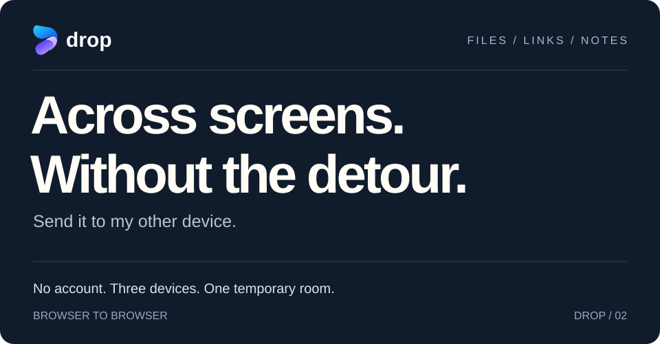
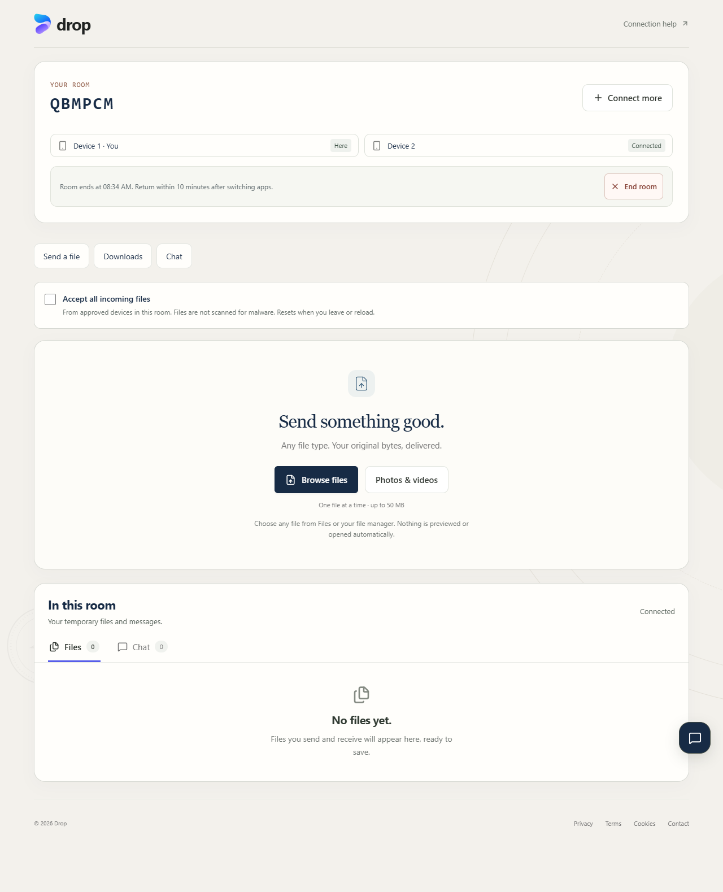
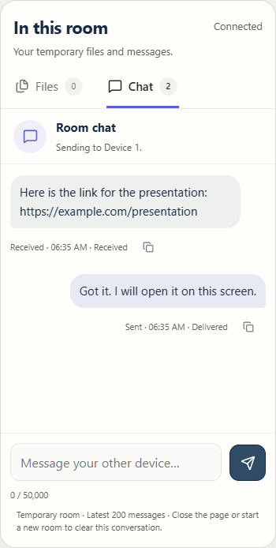
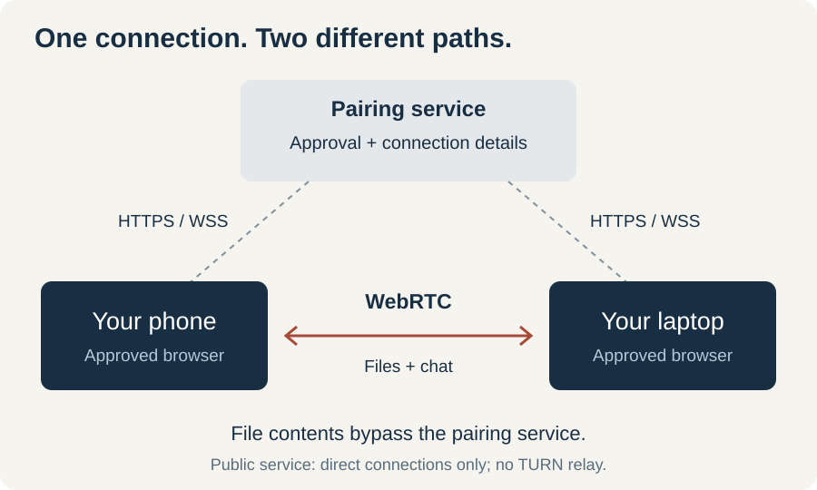

<a href="https://dropem.vercel.app/app"></a>

<h3 align="center">The shortest route to your other screen.</h3>

<p align="center"><a href="https://dropem.vercel.app/app"><strong>OPEN DROP ↗</strong></a> &nbsp; · &nbsp; <a href="#quick-start">Start here</a> &nbsp; · &nbsp; <a href="docs/architecture.md">Under the hood</a> &nbsp; · &nbsp; <a href="#run-locally">Build it yourself</a></p>

<br>

## Your devices, on speaking terms.

A photo on your phone. A PDF on your laptop. A link you want to open somewhere else. Drop gives your devices a shared room so you can move it across without emailing yourself or creating an account.


**Files keep their original bytes.** Send any file extension, up to 50 MiB. The receiver checks SHA-256 before offering the download.

**Text has a place too.** Room chat keeps sent and received notes together, with copy controls and expandable long messages.

**You control what arrives.** Approve each new device once. Accept files individually, or turn on automatic acceptance for that room.

## Quick start

**Phone → laptop. A photo, in three steps.**

1. Open Drop on your laptop and **create a room**.
2. Scan its QR with your phone, enter the five-digit code, or open the private invite. Compare the room name and **approve the phone** on your laptop.
3. Choose a file on your phone. Accept it on your laptop, then **Save file**.

Keep both pages open during transfer. With three devices connected, choose the recipient from the device list.



<details>
<summary>See the mobile chat</summary>

<p align="center"></p>

Screenshots show temporary local rooms and illustrative messages. Those rooms have ended.

</details>

## How your file gets there

The pairing service introduces your devices and handles approval. File contents and chat then travel between the approved browsers over encrypted WebRTC data channels.

[](docs/readme/network.svg)

The pairing server has no file store. The website and pairing service are trusted parts of the connection. SHA-256 checks integrity, not whether a file is safe: Drop does not scan for malware.

**Network limitation:** the public deployment has no TURN relay. Some mobile networks, VPNs and firewalls prevent a direct connection. [Connection help →](https://dropem.vercel.app/connection-help.html)

[Read the architecture, protocol and data lifecycle →](docs/architecture.md)

## Run locally

Requires **Node.js 24** and **npm**. No database or provider account is needed for local development.

```sh
git clone https://github.com/Pranav-Teja-Aluvala/Drop.git
cd Drop
npm ci
npm run dev
```

Open [localhost:5173/app](http://localhost:5173/app). Pair two browser profiles to test on one computer. A phone needs a reachable HTTPS deployment; its localhost points to itself.

<details>
<summary>Build, preview and test</summary>

```sh
npm run build
npm run preview:v2
```

The production preview runs at [localhost:5174](http://localhost:5174/).

```sh
npm test
npx playwright install chromium
npm run test:beta
npm run check:release
npm audit --omit=dev
npm run check:secrets -- --history
```

Browser tests cover recipient isolation, byte-identical downloads, approval, code joining, automatic acceptance, recovery and responsive chat. Use `PLAYWRIGHT_CHANNEL=chrome` for an installed Chrome.

[View CI runs](https://github.com/Pranav-Teja-Aluvala/Drop/actions/workflows/checks.yml). For live checks, set `TEST_BASE_URL` and `TEST_SIGNAL_ORIGIN`, then run `npm run check:live`.

</details>

<details>
<summary>Self-hosting</summary>

Publish `dist/` on a static host and run the pairing service as one long-running Node process. Its in-memory registry is not shared across replicas; server restarts end active rooms.

| Variable | Set on | Purpose |
| :--- | :--- | :--- |
| `PUBLIC_ORIGIN` | Pairing server | Exact HTTPS frontend origin, no trailing slash |
| `VITE_SIGNAL_ORIGIN` | Frontend build | HTTPS pairing-service origin |
| `SITE_ORIGIN` | Frontend build | Canonical site origin |
| `PORT` | Pairing server | Host-supplied listening port |

Build with `npm ci && npm run build`, start the server with `npm start`, and check `/api/health`. Serve the frontend app entry at `/app`.

See [.env.example](.env.example), [Vercel configuration](vercel.json), [Render blueprint](render.yaml) and [Dockerfile](Dockerfile). Optional TURN credentials belong on the server. Every `VITE_` variable is public frontend code.

</details>

## What to expect

| | Current behavior |
| :--- | :--- |
| Devices | Three per room, including the owner |
| Files | 50 MiB each; one active file per direction per peer |
| Retained downloads | Up to 20 files / 150 MiB per peer connection |
| Chat | 50,000 characters per message; latest 200 messages retained |
| Room | Two hours; invitations and join codes expire after ten minutes |
| Returning | Approved devices have a ten-minute return window |
| Storage | Unsaved files and chat stay in page memory; reload clears them |

Return credentials use tab session storage. Interrupted transfers must be sent again. Automatic acceptance resets when leaving or reloading.

## Contribute

Found a rough edge? [Open an issue](https://github.com/Pranav-Teja-Aluvala/Drop/issues/new) with your browser, device, network type and reproduction steps. Use a synthetic file. Pull requests should describe the affected flow and the checks run.

For sensitive findings, follow [SECURITY.md](SECURITY.md).

## License

Original code and documentation are [MIT licensed](LICENSE). Drop branding and artwork are reserved under the [licensing scope](LICENSING.md). Dependencies retain their own [third-party licenses](https://dropem.vercel.app/third-party-notices.html).

---

[Contact](https://dropem.vercel.app/contact.html) · [Privacy](https://dropem.vercel.app/privacy.html) · [Cookies & local data](https://dropem.vercel.app/cookies.html) · [Terms](https://dropem.vercel.app/terms.html)
