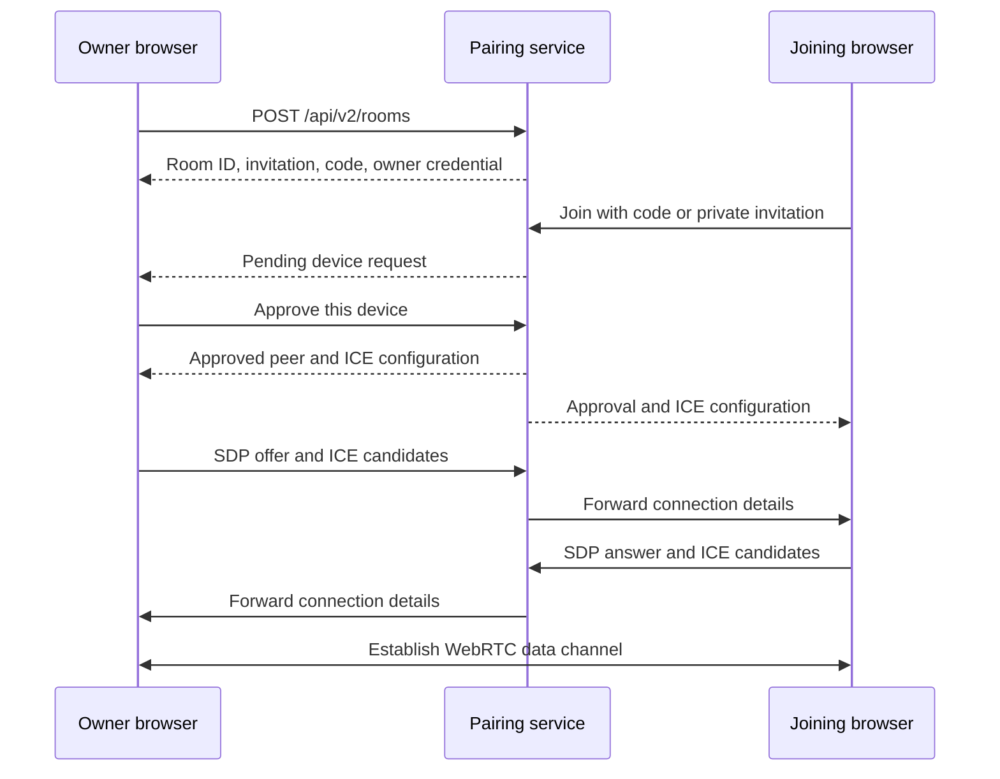
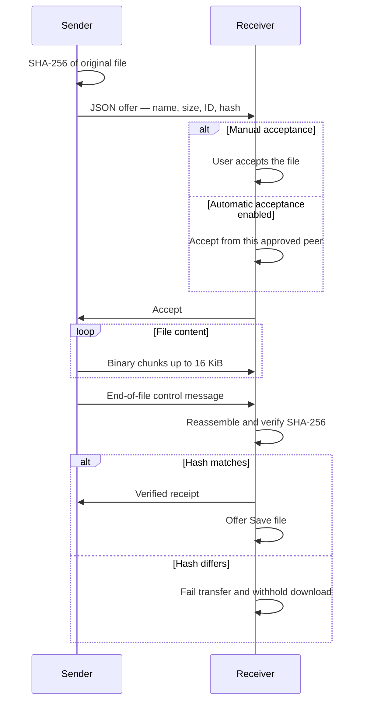

# Architecture and protocols

[← Back to Drop](../README.md)

<strong>Connection architecture</strong> — From invitation to encrypted channel

**Admission.** The five-digit code finds a room. The six-letter name is a screen comparison aid. Owner approval grants admission, and each device receives a separate return credential.

**Network discovery.** ICE selects a route, using STUN to discover network addresses. The public deployment has no TURN relay, so some mobile networks, VPNs and firewalls cannot connect.

**Recovery.** A tab session credential can restore an approved connection within the ten-minute return window. Room membership lives in one server process. Server restarts clear active rooms; independent replicas cannot share this registry.

Implementation entry points are the [room lifecycle](../src/useRoom.ts), [pairing service](../server/v2.mjs) and [ICE configuration](../server/ice.mjs).

<strong>Transfer protocol</strong> — Offer, accept, stream, verify

| Layer | What Drop uses it for |
| :--- | :--- |
| **HTTPS / WSS** | Serve the application and coordinate room admission and WebRTC signaling. |
| **SDP / ICE / STUN** | Exchange connection descriptions and candidates, then find a network route. |
| **RTCDataChannel** | Carry file metadata, binary chunks and messages over an ordered, reliable channel. |
| **SCTP / DTLS** | Browser-managed data-channel transport and encryption in transit. |
| **Web Crypto / SHA-256** | Hash file contents and verify received bytes before exposing a download. |
| **JSON control messages** | Offers, acceptance, cancellation, receipts and message acknowledgements. |

The [transfer implementation](../src/transfer.ts) applies file-size limits, buffered-data backpressure, timeouts and integrity checks. Interrupted files must be sent again.

<strong>Data lifecycle and trust boundaries</strong> — Where things live

| Location | What lives there | Lifetime |
| :--- | :--- | :--- |
| Browser memory | Files, unsaved downloads and chat | Until reload, page termination or room cleanup |
| Tab session storage | Room return credential and owner invitation | Cleared when ending the room; server expiry remains authoritative |
| Pairing service memory | Membership, invitation codes, credentials and signaling state | Room expiry or server restart |
| Device storage | Files explicitly saved by the recipient | Until the user removes them |

The pairing service has no file store. The site and pairing service are trusted to introduce peers. Files and archives are not scanned for malware, and local browser storage is not a separately encrypted vault.

